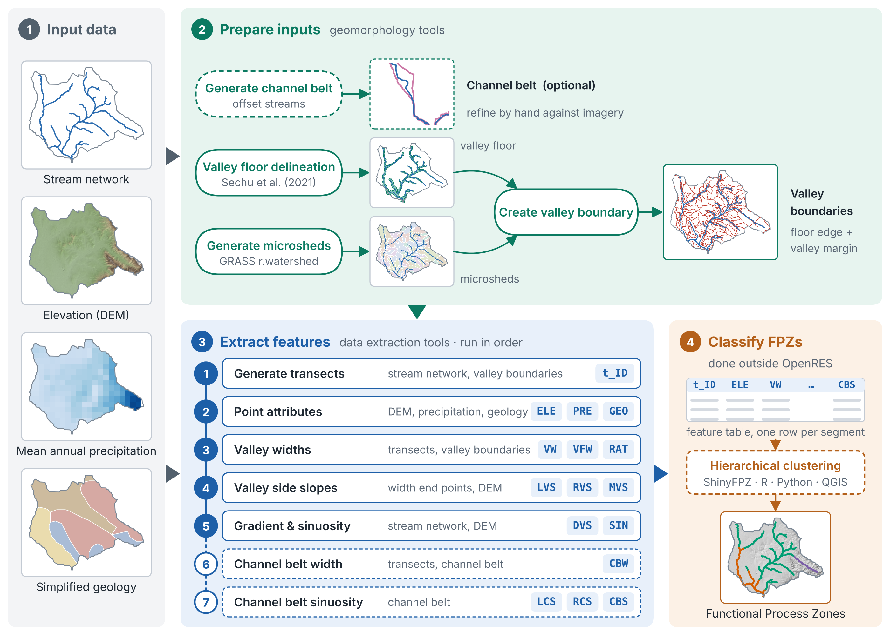
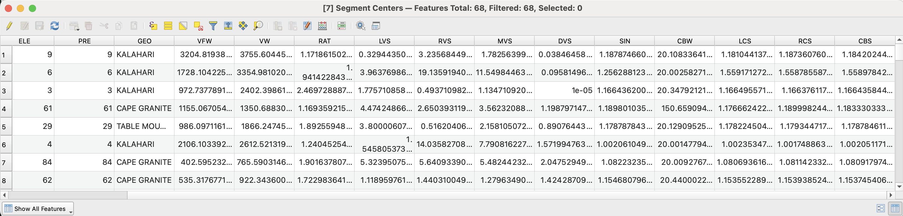

# Open Riverine Ecosystem Synthesis (OpenRES):

## A QGIS plugin for automated extraction of hydrogeomorphic features to support functional process zone classification of river networks

[](https://github.com/ellerbrock/open-source-badges/) 
[](https://www.python.org/) 
[](%5Bhttps://www.gnu.org/licenses/old-licenses/gpl-3.0.html%5D(https://www.gnu.org/licenses/gpl-3.0.html#license-text)) 
[](https://doi.org/10.5281/zenodo.17196890) 
[](https://plugins.qgis.org/plugins/OpenRES) 
[](https://github.com/jollygoodjacob/OpenRES/releases) 
[](https://github.com/jollygoodjacob/OpenRES/commits) 
[](https://GitHub.com/jollygoodjacob/OpenRES/graphs/commit-activity)
[](https://github.com/jollygoodjacob/OpenRES/actions/workflows/tests.yml)

OpenRES is a QGIS plugin that extracts a standard set of 15 hydrogeomorphic features (valley width, valley floor width, side slopes, down-valley slope, sinuosity, channel belt metrics, and more) for every segment of a river network. These features are the inputs used to classify rivers into **Functional Process Zones (FPZs)**: valley-scale reaches (typically 5–10 km) that share similar physical structure and hydrogeomorphic processes, as described by the Riverine Ecosystem Synthesis ([Thorp et al. 2006](https://doi.org/10.1002/rra.901); [Thorp et al. 2023](https://doi.org/10.3389/fevo.2023.1184433)).

Extracting these features by hand is slow, hard to reproduce, and difficult to scale beyond a few reaches. OpenRES turns it into a repeatable sequence of QGIS Processing tools that can be run on whole networks, from the graphical toolbox or from Python.

<p align="center">
  
</p>

## Table of contents

- [Features](#features)
- [Getting started](#getting-started)
  - [Prerequisites](#prerequisites)
  - [Installation](#installation)
  - [Running tests](#running-tests)
- [Usage](#usage)
- [Contributing](#contributing)
- [FAQ](#faq)
- [Citing OpenRES](#citing-openres)
- [License](#license)
- [Contact](#contact)
- [Acknowledgements](#acknowledgements)

## Features

- **Fifteen features per river segment**, written to one point layer and linked to transects and the stream network by a shared `t_ID`.
- **Geomorphology tools** to build the less common inputs: Generate Channel Belt, Valley Floor Delineation ([Sechu et al. 2021](https://doi.org/10.3390/w13060827)), Generate Microsheds, and Create Valley Boundary.
- **QA/QC layers** (left/right reference points for every width measurement) so each value can be checked on the map.
- **Runs in the Processing Toolbox or from Python**, so the same workflow can be clicked through once or scripted across many watersheds.
- **Tested** on QGIS 3.x LTR and QGIS 4 against a synthetic valley with hand-calculated answers and the bundled sample data.

The extraction tools are run in order:

| Tool | Features produced | Required |
|---|---|---|
| [1] Generate Transects | `t_ID` (links transects, segment centers, and streams) | Yes |
| [2] Extract ELE, PRE, and GEO | Elevation (`ELE`), mean annual precipitation (`PRE`), geologic class (`GEO`) | Yes |
| [3] Extract VW, VFW, and RAT | Valley width (`VW`), valley floor width (`VFW`), VW:VFW ratio (`RAT`) | Yes |
| [4] Extract LVS, RVS, and MVS | Left, right, and mean valley side slope (`LVS`, `RVS`, `MVS`) | Yes |
| [5] Extract DVS and SIN | Down-valley slope (`DVS`), channel sinuosity (`SIN`) | Yes |
| [6] Extract CBW | Channel belt width (`CBW`) | Optional |
| [7] Extract LCS, RCS, and CBS | Left, right, and mean channel belt sinuosity (`LCS`, `RCS`, `CBS`) | Optional |

Each tool's dialog in QGIS includes help text for its parameters. Algorithm details are in [help/Functions_description.md](help/Functions_description.md).

## Getting started

### Prerequisites

- **QGIS 3.28 or later** (QGIS 4 is supported). GRASS, which ships with QGIS, is used by the Valley Floor Delineation and Generate Microsheds tools.
- **Input data** for your watershed, all in the same projected CRS with units in meters (e.g., UTM):

| Layer | Type | Notes |
|---|---|---|
| Stream network | Line | Segmented to the reach length you want to classify; ideally corrected to match channel positions in imagery. |
| Valley boundary lines | Line | Valley floor edge and valley margin. Can be built with the OpenRES geomorphology tools. |
| Digital elevation model | Raster | 30 m or finer recommended. |
| Mean annual precipitation | Raster | |
| Simplified geology | Polygon | Generalized classes, e.g., alluvial, mixed, bedrock. |
| Channel belt *(optional)* | Line | Needed only for tools [6] and [7]. Start from Generate Channel Belt, then refine by hand. |

### Installation

In QGIS, open **Plugins → Manage and Install Plugins**, search for **OpenRES**, and click **Install Plugin**. The tools appear under **OpenRES** in the Processing Toolbox (**Processing → Toolbox**).

For offline installation, download `OpenRES.zip` from the [latest release](https://github.com/jollygoodjacob/OpenRES/releases) and use **Install from ZIP** in the same dialog.

### Running tests

The test suite needs only QGIS. From a copy of this repository, paste this into the QGIS Python Console (**Plugins → Python Console**), replacing the path:

```python
import runpy; _ = runpy.run_path(r"C:\path\to\OpenRES\tests\run_tests.py", run_name="__main__")
```

Or, with Docker:

```bash
docker run --rm -v "$PWD":/OpenRES -w /OpenRES -e QT_QPA_PLATFORM=offscreen qgis/qgis:ltr python3 tests/run_tests.py
```

See [tests/README.md](tests/README.md) for terminal options and troubleshooting. Tests also run on every push and pull request.

## Usage

### Example: Eerste River, South Africa

The repository includes a complete input dataset for the Eerste River catchment (~390 km², Western Cape) in [sample_data/Eerste_rivier.zip](sample_data/Eerste_rivier.zip). Unzip it, then either run the tools from the Processing Toolbox in the order [1] to [7], or run the whole workflow from the QGIS Python Console:

```python
import os
import processing
from qgis.core import QgsProject, QgsRasterLayer, QgsVectorLayer

DATA = r"C:\path\to\Eerste_rivier"  # the unzipped sample data folder
TMP = "TEMPORARY_OUTPUT"

def vector(path):
    return QgsVectorLayer(os.path.join(DATA, path), os.path.basename(path), "ogr")

def raster(path):
    return QgsRasterLayer(os.path.join(DATA, path), os.path.basename(path))

streams = vector("Eerste_stream_network/Eerste_stream_network/Eerste_stream_network_2km_final.shp")
valley  = vector("Eerste_valley_boundary/Eerste_valley_boundary.shp")
belt    = vector("Eerste_channel_belt/Eerste_channel_belt.shp")
geology = vector("Eerste_geology/Eerste_geology/Eerste_geology.shp")
dem     = raster("Eerste_elevation/Eerste_elevation/Eerste_SRTM_30m_extent.tif")
precip  = raster("Eerste_precipitation/Eerste_MAP/Eerste_MAP_extent.tif")

# [1] Transects perpendicular to each segment, extended until they reach the valley lines
s1 = processing.run("openres:generate_transects", {
    "RIVER_LAYER": streams, "LINE_LAYER": valley,
    "EXTENSION_INCREMENT": 250, "MAX_LENGTH": 50000,
    "TRANSECTS": TMP, "CENTER_POINTS": TMP, "OUTPUT_STREAM": TMP})

# [2] ELE, PRE, GEO
s2 = processing.run("openres:extract_point_attributes", {
    "POINTS": s1["CENTER_POINTS"], "RASTER1": dem, "RASTER2": precip,
    "POLYGONS": geology, "POLY_FIELD": "GEOLOGY", "OUTPUT": TMP})

# [3] VW, VFW, RAT
s3 = processing.run("openres:extract_valley_width", {
    "TRANSECTS": s1["TRANSECTS"], "CENTER_POINTS": s2["OUTPUT"],
    "VALLEY_LINES": valley, "STREAM_NETWORK": s1["OUTPUT_STREAM"],
    "LEFT_VFW": TMP, "RIGHT_VFW": TMP, "LEFT_VW": TMP, "RIGHT_VW": TMP, "CENTER_OUT": TMP})

# [4] LVS, RVS, MVS
s4 = processing.run("openres:extract_side_slopes", {
    "CENTER": s3["CENTER_OUT"], "LEFT_VW": s3["LEFT_VW"], "LEFT_VFW": s3["LEFT_VFW"],
    "RIGHT_VW": s3["RIGHT_VW"], "RIGHT_VFW": s3["RIGHT_VFW"], "RASTER": dem, "OUTPUT": TMP})

# [5] DVS, SIN
s5 = processing.run("openres:extract_dvs_sinuosity", {
    "CENTER_POINTS": s4["OUTPUT"], "STREAM_SEGMENTS": s1["OUTPUT_STREAM"],
    "ELEVATION": dem, "OUTPUT": TMP})

# [6] CBW (optional)
s6 = processing.run("openres:extract_cbw", {
    "TRANSECTS": s1["TRANSECTS"], "CENTER_POINTS": s5["OUTPUT"],
    "CHANNEL_BELT": belt, "STREAM_NETWORK": s1["OUTPUT_STREAM"],
    "LEFT_CB": TMP, "RIGHT_CB": TMP, "CENTER_OUT": TMP})

# [7] LCS, RCS, CBS (optional)
s7 = processing.run("openres:extract_channel_belt_sinuosity", {
    "CENTER_POINTS": s6["CENTER_OUT"], "CHANNEL_BELT": belt, "OUTPUT": TMP})

features = s7["OUTPUT"]
features.setName("Eerste OpenRES features")
QgsProject.instance().addMapLayers([s1["OUTPUT_STREAM"], s1["TRANSECTS"], features])
processing.run("native:savefeatures", {
    "INPUT": features, "OUTPUT": os.path.join(DATA, "eerste_openres_features.csv")})
```

The result is one point per river segment with all 15 features, saved to `eerste_openres_features.csv`:

<p align="center">
  
</p>

To check a measurement, compare the transects and the left/right reference points from tools [3] and [6] (e.g. `s3["LEFT_VFW"]`) against the valley lines on the map.

### From features to FPZs

FPZs are usually delineated by hierarchical clustering of these features ([Maasri et al. 2019](https://doi.org/10.1016/j.scitotenv.2019.04.394); [Elgueta et al. 2019](https://doi.org/10.1002/rra.3557)). OpenRES does not do the classification itself. Export the feature table and use:

- [ShinyFPZ](https://github.com/jollygoodjacob/ShinyFPZ), a companion R Shiny app for FPZ classification and visualization of OpenRES output, or
- R, Python, or a QGIS clustering plugin such as Attribute Based Clustering.

Join the resulting classes back to the stream network output from tool [1] on `t_ID` to map the zones.

## Contributing

Contributions are welcome, from bug reports to new tools. See [CONTRIBUTING.md](CONTRIBUTING.md) to get started, and run the [test suite](#running-tests) before opening a pull request that changes an algorithm.

## FAQ

**My inputs are in a geographic CRS (degrees). Will OpenRES work?**
Reproject every layer to the same projected CRS in meters first. Widths, slopes, and lengths are computed in layer units.

**Some segments have empty VW or VFW values. Why?**
The transect for that segment did not reach a valley line on both sides within the maximum length, usually because of a gap in the valley boundary layer. Inspect the transect and reference points for that `t_ID`, close the gap, and rerun from tool [1].

**Do I need a channel belt layer?**
No. Tools [1]–[5] produce the ten core features. The channel belt is needed only for `CBW`, `LCS`, `RCS`, and `CBS`.

**How long should my river segments be?**
FPZs are typically 5–10 km long, but shhould be matched to the scale of your inquiry. OpenRES computes features for whatever segments you provide, so split the network to the scale of your question. The sample data uses ~2 km segments.

## Citing OpenRES

If you use OpenRES, please cite it using the metadata in [CITATION.cff](CITATION.cff) (GitHub's **Cite this repository** button) or the archived release on Zenodo: [10.5281/zenodo.17196890](https://doi.org/10.5281/zenodo.17196890).

## License

OpenRES is distributed under the GNU General Public License v3.0 or later. See [LICENSE](LICENSE).

## Contact

- Bug reports and feature requests: [open an issue](https://github.com/jollygoodjacob/OpenRES/issues).
- Other questions: Jacob Nesslage, [jnesslage@ucmerced.edu](mailto:jnesslage@ucmerced.edu).

## Acknowledgements

OpenRES was developed in the Earth Observation and Remote Sensing Laboratory at the University of California, Merced. We thank Matthew Rossi, Rachel S. Meyer, E. Natasha Stavros, Madeline Slimp, Meghan T. Hayden, Will Varela, and Martin C. Thoms for feedback and support during development.
